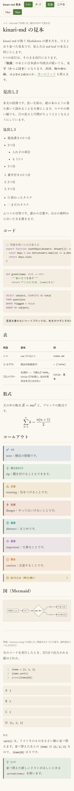
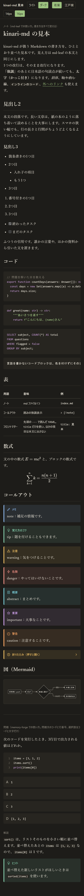
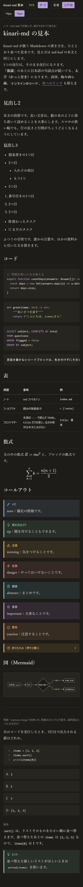
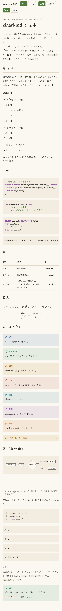
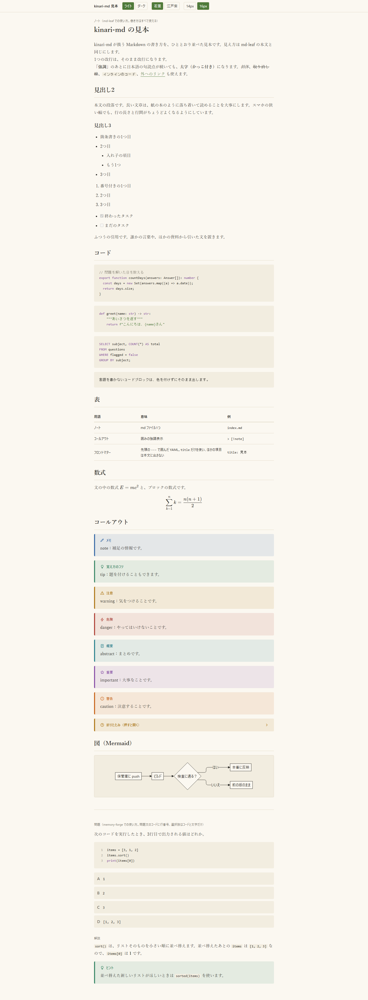
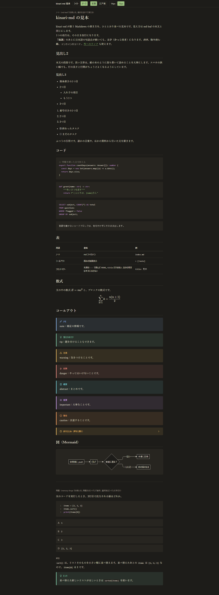

<!--
変更の仕様のひな形。コピーして docs/changes/<年-月-日>-<何をするか>.md を作る（例：2026-09-17-add-due-date.md）。
「なぜ」〜「調べたこと」は、AIが下書きし、人間がプロトタイプを触って直し、合意して決める（/dev-proto）。「画面」のスクリーンショットは、合意したときに足す。
「設計」以降はAIが書いて実装まで進め、人間は機能の PR でレビューする（/dev-build）。
スクリーンショットは、このファイルと同じ名前のフォルダに置く（例：2026-09-17-add-due-date/list-empty.png）。
-->

# Markdown を md-leaf と同じ HTML と見た目にできる（#2）

## なぜ

md-leaf と memory-forge は、Markdown の変換と本文の見た目をそれぞれ持っていて、片方で直すともう片方とずれる（`docs/overview.md`）。まず md-leaf の変換と本文の見た目をこのパッケージに移し、アプリが入れられる最初の版（v0.1.0）にする。md-leaf がこれに替えるのは、このあと md-leaf の側で行う（`docs/overview.md` の「アプリが移る順番」の3）。

## 影響する今の仕様

- 新規：`docs/specs/markdown.md`（変換の入口が何を返し、どう書き換えるか）
- 新規：`docs/specs/sample-page.md`（見本のページ。今は入れ物だけで、`docs/specs/` にはまだ書いていない）

## 使う場面

1. md-leaf を作る人が、ノートの Markdown（フロントマターの `title`、コールアウト、コード、数式、表、Mermaid を含む）を `kinari-md/markdown` に渡すと、題・HTML・見出しの一覧が返る。HTML を本文の入れ物（`kinari-body`）に入れ、本文の CSS を読み込むと、今の md-leaf と同じ見た目で出る
2. md-leaf を作る人が、`notes/a.md` の中の `[次へ](b.md)` を、自分のノートの URL（`/notes/b`）に書き換える関数を渡すと、HTML のリンクがその URL になる。リンク先のノートがないと関数が答えたものは、「切れたリンク」の一覧に入る
3. 見本のページを開いた本人が、上の帯で「ダーク」「江戸紫」「14px」を押すと、すぐにその見た目になり、URL が `?theme=dark&accent=forge&size=14` になる。読み込み直しても同じ見た目で開き、Mermaid の図はダークの色で描き直される

## 受け入れ条件

### 変換（`kinari-md/markdown`）

- Markdown を渡すと、題・HTML・見出しの一覧が返る
  - 題：フロントマターの `title`。数として読まれたもの（`title: 2024`）も題にする。`title` がない・空・YAML が壊れているときは「なし」（題をファイル名にするかはアプリが決める）。フロントマターは本文に出さない
  - 見出しの一覧：本文の h2・h3 を、本文の順に、文字と深さで返す。見出しには一覧と結び付く印が付く
- 書き方と出し方は md-leaf と同じ（md-leaf の変換のテストがそのまま通る）
  - GFM（表・タスク・取り消し線・自動リンク）。1つの改行は改行にする。閉じの強調の直前が日本語の括弧・句読点でも強調にする
  - コールアウト：Obsidian 標準の種類と別名、題（なければ種類ごとの日本語の題）、折りたたみ（`-` は閉じて始まり、`+` は開いて始まる）。決まりにない種類は note と同じに出す
  - コード：言語を書いたブロックは色分けする。言語のないもの・知らない言語は色を付けずに出す
  - 数式：文の中（`$…$`）とブロック（`$$…$$`）。式にできないものは、書いたままの文字を出す
  - 表：列の幅を、いちばん長いセルの文字数で3段階に分ける。表は枠の中で横にスクロールする
  - Mermaid：` ```mermaid ` のブロックは、ブラウザで図にする印を付けたコードとして出す
  - ノートの中の HTML のタグは、動かさずに文字として出す
  - 外へのリンク（`http://`・`https://`）は別のタブで開く
- リンクと画像の書き換え：アプリが関数を渡すと、相対のリンクと画像の場所をその関数で書き換える
  - 関数が「書き換えない」と答えたものは、そのまま出す。関数を渡さなければ、何も書き換えない
  - 関数が「行き先がない」と答えたものは、書き換えたうえで、切れたリンク・切れた画像の一覧（書かれたままの形）に入る
  - アプリの中へのリンク（関数が書き換えたもの）には、アプリが見分けられる印が付く（md-leaf は、印の付いたリンクを読み込み直さずに移る）
  - 画像だけの段落では、画像の下に代わりの文字（alt）を出す

### 本文の見た目（本文の CSS）

- 本文の入れ物の中の、見出し・段落・リスト・タスク・引用・リンク・文の中のコード・コードブロック・表・コールアウト・数式・図・画像が、`docs/ui.md` の決まりと、合意した見本のページの画像のとおりに出る
- 色はアプリのトークン（`bg`・`surface`・`text`・`muted`・`border`・`accent`・`info`・`success`・`warning`・`danger`・`font-body`・`font-ui`・`font-mono`）と、kinari-md の Markdown の色だけを読む。値を本文の CSS に書かない
- ライト・ダークは `<html data-theme>` だけで変わる。本文の CSS にライト・ダークを分けた書き方がない
- 本文の文字の大きさは、アプリが `--reading-size` を変えると、見出しやコードの大きさも同じ倍率で変わる
- スマホの幅では、コールアウトとコードの内側の余白が狭くなる。本文の中の横に長いもの（コード・表・数式・図）は、その枠の中でだけ横にスクロールし、ページは横にスクロールしない
- 折りたたみのコールアウトは、見出しを押すと開閉する

### 図（Mermaid）

- アプリが本文の入れ物を渡すと、中の Mermaid の印のコードを図にする。図の線と文字は `text`、地は `surface`、強調は `accent` の色
- `<html data-theme>` が変わると、今の色で描き直す
- 書き方を間違えた図は、元の文字をコードブロックのまま出す（エラーの文は出さない）
- 図は縮めず、収まらなければ枠の中で横にスクロールする

### 見本のページ

- ノートの見本（合意した画像のノートの部分）を、本物の変換と本文の CSS で出す
- 上の帯に、ライト/ダーク・若葉/江戸紫・14px/16px のボタンがある。押すとすぐに変わり、選んでいるボタンは差し色の地になる
- 押すと URL の `?theme=`・`accent=`・`size=` に残り、その URL で開くと同じ見た目で開く。何もなければライト・若葉・16px
- 帯の中身と本文は、PC の幅では本文の幅（prose）で真ん中にそろう。帯はスクロールしても上に残る

### 版

- `kinari-md/markdown`・`kinari-md/body.css`・`kinari-md/mermaid`・`kinari-md/tokens.css` の入口から読み込める
- `CHANGELOG.md` に v0.1.0 で入ったものが書いてあり、`package.json` の版が 0.1.0

## 画面

立ち上げで合意した見本のページ（`docs/agreed-screens/`）。問題の例（行番号・選択肢・解説）の部分は #4 で作るので、この Issue ではノートの部分（題「kinari-md の見本」から図（Mermaid）まで）を合わせる。

### 見本のページ（sample）

| 状態 | 表示 | スクリーンショット |
| --- | --- | --- |
| ライト・若葉・16px（スマホ） | 帯（題・ライト/ダーク・若葉/江戸紫・14px/16px）、「ノート（md-leaf での使い方。書き方はすべて使える）」の小さな説明、題、見本の本文 |  |
| ダーク・若葉・16px（スマホ） | 同じ。墨の地 |  |
| ダーク・江戸紫（スマホ） | リンク・選んだボタンが江戸紫 |  |
| ライト・14px（スマホ） | 本文と見出しが小さくなる。帯は変わらない |  |
| ライト（PC） | 帯の中身と本文が prose の幅で真ん中 |  |
| ダーク（PC） | 同じ。墨の地 |  |

- 見本の本文の Markdown：[sample.md](2026-11-22-port-md-leaf-rendering/sample.md)（合意した画像を作ったもの）
- 帯：`position: sticky` で上に残る。ボタンの組（ライト・ダーク／若葉・江戸紫／14px・16px）ごとに間を空ける
- 画像に写らない状態（テストで確かめる）：折りたたみを開いた状態、描けない Mermaid の図

## やらないこと

- 問題の例（行番号・選択肢・解説）と、書き方を絞る仕組み・サニタイズ・行番号（#4）
- 見本のページのデプロイ（#3）
- md-leaf を kinari-md に替えること（md-leaf の側の Issue）。md-leaf のリポジトリにはコミットしない
- v0.1.0 のタグを打つこと（マージのあとに人が打つ。下の「決まっていないこと」）
- 目次の画面の部品、本文の文字の大きさのメニュー（`docs/overview.md`）
- 見本のページに画像を足すこと（合意した画像にない。画像の見た目はテストとコードで確かめる）

## 先に要る機能

- #1（開発を始められる）：閉じていて、main に入っている

## 決まっていないこと

- [x] 画像を撮る Docker のイメージで、日本語の太字が出ない（#1 の PR で分かった。イメージにある日本語の書体は Regular だけで、明朝もない）。どうする？（推す答え：公式のイメージをもとに、日本語の書体（Noto Sans CJK JP・Noto Serif CJK JP。太字あり）を版を固定して入れたイメージを Dockerfile で作り、手元でも CI でもそれで撮る。比べた案：そのままにする＝手間はないが、太字と明朝が画像に出ず、崩れを画像で見つけられない／テストのときだけ npm の書体（`@fontsource`）をページに読み込む＝CI は今のままだが、撮る画面がふだんのページと少し違う） → おすすめのまま（Dockerfile で書体を入れたイメージを作る）
- [x] パッケージのライセンスは？（推す答え：MIT。`LICENSE` を置き、`package.json` に書く。比べた案：書かない＝自分のアプリで使うだけなら困らないが、公開のリポジトリなのに、ほかの人は使ってよいか分からない） → おすすめのまま（MIT）
- [x] v0.1.0 の出し方は？（推す答え：この PR で `package.json` の版を 0.1.0 にし、`CHANGELOG.md` を書く。マージのあと、人が main に `v0.1.0` のタグを打つ。比べた案：版を上げる PR を別に出す＝変わったものと版の記録が分かれる／AI がタグを打つ＝取り消しにくく、マージしない決まりと同じく人がするほうがよい） → おすすめのまま（この PR で 0.1.0 と CHANGELOG。タグはマージのあとに人が打つ）

## 技術の確認表

| 項目 | 当てはまるもの | 決めた人 |
| --- | --- | --- |
| 保存するデータ | なし | 人（`docs/overview.md`） |
| 外部サービス | なし | AI |
| 認証・権限 | なし | AI |
| 費用 | なし | AI |
| 個人情報 | なし | AI |
| デプロイの環境 | なし（デプロイは #3）。配る中身（`package.json` の `dependencies` と `exports`）が増える。CI の画像のジョブは、公式のイメージの中で動かすのをやめ、Dockerfile のイメージを作って撮る | 人（「決まっていないこと」）・AI |
| 新しいライブラリ | unified 一式（remark-parse・remark-gfm・remark-frontmatter・remark-math・remark-breaks・remark-cjk-friendly・remark-rehype・rehype-stringify）・highlight.js・KaTeX・mermaid（人。`docs/overview.md`）。yaml・vfile・@types/hast・@types/mdast（AI。条件に合う）。画像を撮るイメージに入れる日本語の書体 fonts-noto-cjk（人。「決まっていないこと」） | 人・AI |
| 取り消せない操作 | v0.1.0 のタグ（人が打つ。「決まっていないこと」） | 人 |
| 共通の部品・トークン | Markdown の色のトークンは #1 のまま使う。値は変えない | AI |
| `docs/design.md` の決まり | 足す：入口の分け方（変換・本文の CSS・図）、アプリから渡す関数の形、ノートの HTML を文字にする前提（`raw` を作るのは KaTeX と highlight.js だけ）。変える：「見本のページの画像は、Playwright 公式の Docker イメージで撮って比べる」を、書体を入れたイメージで撮る形に（`docs/overview.md` の「技術」のテストの行も） | 人（書体）・AI（仕上げで書く） |

## 調べたこと

- md-leaf の今の作り（移す元）：変換は `src/lib/markdown.ts`（`callouts.ts`・`headings.ts`・`highlight.ts`・`math.ts`・`tables.ts`・`note-images.ts`・`note-links.ts`）、本文の CSS は `src/components/note-body.css`、図は `src/components/mermaid.ts` と `note-body-content.tsx`。テストは `src/lib/markdown.test.ts`・`callouts.test.ts`・`headings.test.ts` など
- md-leaf はライト・ダークを `<html>` の `.dark` で見分け、Markdown の色の名前も kinari-md と違う（`--color-note` など）。kinari-md は `data-theme` と `docs/ui.md` の名前にする。md-leaf の側の名前を揃えるのは、tsubokura14/md-leaf#32・#33
- md-leaf のリンクと画像の書き換え（`note-links.ts`・`note-images.ts`）は、ノートの置き場所と URL の形に頼っているので、kinari-md には移さず、md-leaf が関数として渡す

---

## 設計

移す元は md-leaf（`../md-leaf` の `src/lib/markdown.ts` ほか。「調べたこと」）。中身は md-leaf のまま移し、md-leaf だけの部分（ノートの置き場所・URL・`.dark`・`next/navigation`・Tailwind の `@reference`）を、アプリから渡すもの・`data-theme`・普通の CSS に替える。

### 変えるファイル

| 場所 | 中身 |
| --- | --- |
| `src/markdown/index.ts` | 入口 `kinari-md/markdown`。`renderMarkdown(source, options?)` と型だけを出す。今の `packageName` は消す |
| `src/markdown/render.ts` | unified の処理の並び（md-leaf の `markdown.ts`。フロントマター・HTML を文字に・外へのリンク） |
| `src/markdown/callouts.ts`・`headings.ts`・`highlight.ts`・`math.ts`・`tables.ts` | md-leaf の同じ名前のファイルを移す |
| `src/markdown/links.ts` | リンクと画像の書き換え（アプリの関数を呼ぶ）と、画像だけの段落の `figure` |
| `src/markdown/*.test.ts` | md-leaf の `markdown.test.ts`・`callouts.test.ts`・`headings.test.ts` を移す。書き換えのテストは関数を渡す形にする |
| `src/styles/body.css` | 入口 `kinari-md/body.css`。`.kinari-body` の中の見た目（md-leaf の `note-body.css`）。先頭で `katex/dist/katex.min.css` を読み込む |
| `src/mermaid/index.ts` | 入口 `kinari-md/mermaid`。`drawMermaid(body: HTMLElement): () => void`（md-leaf の `mermaid.ts` と `note-body-content.tsx` の描く部分） |
| `package.json` | `exports` に `./body.css`・`./mermaid` を足す。`dependencies` を足す。版 0.1.0、`license: MIT`、`private` を外さない（npm に出さないため） |
| `LICENSE`・`CHANGELOG.md` | MIT と、v0.1.0 で入ったもの |
| `sample/app/` | 見本の本文（`sample.md` を移したもの）を、サーバーの部品で `renderMarkdown` して `.kinari-body` に入れる。帯（ライト/ダーク・若葉/江戸紫・14px/16px）、図を描くブラウザの部品 |
| `e2e/`・`playwright.config.ts` | 見本のページの操作のテストと画像。PC の幅の project を足す |
| `docker/playwright/Dockerfile`・`docker/playwright/fonts.conf`・`scripts/playwright-docker.mjs`・`.github/workflows/ci.yml` | 日本語の書体を入れたイメージで撮る |

### データ（アプリとの受け渡しの形）

```ts
type RenderOptions = {
  /** 相対のリンク（a の href）と画像（img の src）を書き換える。渡さなければ書き換えない */
  resolve?: (target: { kind: "link" | "image"; href: string }) =>
    | { href: string; missing?: boolean } // 書き換えたあとの場所と、行き先がないか
    | undefined; // 書き換えない
};
type RenderedMarkdown = {
  title: string | undefined;
  html: string;
  headings: { id: string; text: string; depth: 2 | 3 }[];
  brokenLinks: string[]; // 書かれたままの形（decodeURI したもの）
  brokenImages: string[];
};
```

- 関数に渡すのは「相対」のもの（スキーム付き・`/` で始まる・`#` で始まるものは渡さない）。`.md` かどうかなどの見分けはアプリがする（ノートの置き場所はアプリごとに違うため。`docs/overview.md`）
- 書き換えたリンクに `data-internal-link` を付ける（画像には付けない）
- 見出しの印は md-leaf のまま（`headings.ts` の id と `data-heading`）

### 理由と、残す場所

- 入口を4つに分ける・図を React に頼らない関数にする・関数の形（「AIが決めたこと」）→ `docs/design.md` に「入口の分け方」「アプリから渡す関数の形」を足す
- ノートの HTML を文字にし、`raw` を作るのは KaTeX と highlight.js だけ → `render.ts` の `rehypeStringify` のコメント（md-leaf のまま）と、`docs/design.md` に前提として1行
- 本文の CSS は Tailwind に頼らない普通の CSS にする（`@reference`・`@variant` を使わない）。スマホと PC の切り替えは `@media (min-width: 64rem)`（見本の `--breakpoint-lg` と同じ。CSS 変数はメディアクエリに書けないため）。理由：アプリの Tailwind の設定に左右されないため（Markdown の色を普通の CSS 変数で配るのと同じ）→ `docs/design.md` の「Markdown の色は普通の CSS 変数で配る」を本文の CSS にも広げて書く
- 文字の大きさ：`.kinari-body` の `font-size` を `var(--reading-size)` にし、見出し・コードなどは `em` で倍率をかける → `body.css` のコメント
- 図の描き直しは `<html>` の `data-theme` の変化を `MutationObserver` で見る → `src/mermaid/index.ts` のコメント
- 画像を撮るイメージ（「AIが決めたこと」）→ `docs/design.md` の「見本のページの画像は…」を直し、`docs/overview.md` の「技術」のテストの行も直す
- `docs/design.md` と食い違うところ：画像を撮るイメージだけ（人が「決まっていないこと」で決めた）。ほかは食い違わない

## AIが決めたこと

<!--
decisions スキルの「AIが決めてよいもの」で、AIが選んだもの。人は PR で見る。
例：- 日付の表示に date-fns を入れる。理由：表示の書式を1つのファイルに閉じられる。比べた案：Intl.DateTimeFormat（相対表示「あと3日」が書けない）
-->

- 入口を4つに分ける：`kinari-md/markdown`（変換。サーバーで動く）、`kinari-md/body.css`（本文の CSS。KaTeX の CSS も中で読み込む）、`kinari-md/mermaid`（図を描く。ブラウザで動く）、`kinari-md/tokens.css`（#1 のまま）。理由：サーバーで動くものとブラウザで動くものを分け、mermaid（大きい）を図のあるページでだけ読み込めるようにする。比べた案：1つの入口にまとめる（サーバーの変換に mermaid が混ざる）
- 図を描く入口は React に頼らない関数にする（本文の入れ物の要素を渡すと描き、`data-theme` の変化を見て描き直し、やめる関数を返す）。理由：アプリの作りに頼らず、どのアプリでも呼べる。比べた案：React の部品にする（React の版にしばられる）
- リンクと画像の書き換えの関数は、相対の href・src を受け取り、書き換えたあとの場所と「行き先がない」かを返す（書き換えないときは何も返さない）。理由：md-leaf の切れたリンクの一覧と、ノートの置き場所に頼らない作りを両方満たす。比べた案：書き換えたあとの文字だけを返す（切れたリンクの一覧が作れない）
- アプリの中へのリンクに付ける印は `data-internal-link`。理由：md-leaf だけの名前（`data-note-link`）にしない。md-leaf が替えるときに、クリックを受ける側の名前を直す
- 本文の入れ物のクラスは `kinari-body`（合意した見本のページと同じ）
- 依存は md-leaf と同じ版を `dependencies` に、版を固定して入れる。理由：md-leaf と同じ出し方にするため。比べた案：`peerDependencies`（アプリが自分で全部入れる必要がある）
- 配る `src/` が型で使う `vfile`・`@types/hast`・`@types/mdast` も、md-leaf（devDependencies）と違い `dependencies` に入れる。理由：アプリの `tsc` が `node_modules/kinari-md/src` を型チェックするので、アプリに入っていないと型が見つからない。比べた案：devDependencies のまま（unified の依存として入るのに頼ることになり、入れ方によっては型が見つからない）
- 見出しの型と処理の名前は、ノートに限らないので `Heading`・`collectHeadings` にする（md-leaf は `NoteHeading`・`noteHeadings`）
- md-leaf の変換のテストを、書き換えの関数の形に合わせて移す。md-leaf のノートの置き場所に頼るテスト（`note-links`・`note-images` の中身）は移さない
- 見本のページの本文には画像を入れない（合意した画像にない）。画像の出し方は変換のテストで、見た目はコードで確かめる
- 見本のページの帯の状態は URL だけに持つ（保存しない）
- 画像を撮るイメージ：Dockerfile は `FROM mcr.microsoft.com/playwright:v<入れた版>-noble` に `fonts-noto-cjk` を版を固定して入れ、fontconfig の別名で `Noto Serif JP`・`Noto Sans JP` を `Noto Serif CJK JP`・`Noto Sans CJK JP` に当てる（トークンの書体の並びはそのまま）。イメージの名前に Dockerfile の中身から作った値を入れ、Dockerfile を変えたら作り直す。CI も `scripts/playwright-docker.mjs` で同じイメージを作って撮る。理由：手元と CI が同じ手順・同じイメージになる。比べた案：作ったイメージを GitHub Container Registry に置く（置き場所と更新の手間が増える）／CI だけ root で書体を入れる（手元と手順が分かれる）
- 画像を撮るイメージの Dockerfile は、もとのイメージの版を書かず、`scripts/playwright-docker.mjs` が入れた `@playwright/test` の版を `ARG PLAYWRIGHT_VERSION` で渡す。イメージの名前にもその版を入れる。fonts.conf の別名が当たっていることは、イメージを作るときに `fc-match` で確かめる。理由：Playwright を上げたときに Dockerfile の直し忘れでブラウザが見つからなくなるのを防ぐ。fontconfig は設定ファイルが読めなくても警告だけで進むため。比べた案：Dockerfile に `v1.65.0` を書く（版を上げるたびに2か所を直す）
- 書き換えの関数に渡す `href` は、HTML に出る形（符号化されたもの。`#`・`?` のあとも含む）にする。切れたリンクの一覧だけは `decodeURI` した形。理由：md-leaf の `resolveNoteLink`・`resolveImageSrc` が今この形を受けて自分で読み解くので、md-leaf が替えるときに中身を変えずに渡せる。比べた案：`decodeURI` した形を渡す（md-leaf の読み解きを直す必要があり、`%2F` などの区別が消える）
- 本文の CSS の文字の倍率は、md-leaf の rem の値をそのまま em にする（h2 は 1.5em、h3 は 1.25em、コード・表・コールアウトの見出し・画像の代わりの文字は 0.875em）。余白は `--spacing` の段階のままで、本文の大きさでは変えない。理由：`--reading-size` が 16px のとき md-leaf と同じ大きさになり、見出しとコードが本文と同じ倍率で変わる。比べた案：トークンの割り算（`calc(var(--text-xl) / var(--text-base) * 1em)`。長さどうしの割り算は使えるブラウザが限られる）
- 図の字の大きさは md-leaf のまま、画面の部品と同じ `--text-sm`（rem ならルートの字の大きさで px にする）にし、`--reading-size` では変えない。mermaid の設定を作る部分は `src/mermaid/config.ts` に分け、Node のテストで確かめる。理由：図は表と違い、大きさを変えると描き直しが要る（今は `data-theme` の変化だけを見る）。比べた案：本文の大きさに合わせる（`--reading-size` の変化も見て描き直す必要がある）
- `[data-heading]` の `scroll-margin-top`（md-leaf の上の帯の高さに合わせたもの）は本文の CSS に移さない。理由：帯の高さはアプリが決める。md-leaf が替えるときに自分の CSS で足す
- 見本のページの帯は、選んだものを `history.replaceState` で URL に書き（履歴を増やさない）、3つとも書く（`?theme=…&accent=…&size=…`）。知らない値は既定にする。最初の描画の前に `<head>` のスクリプトで URL のものを `<html>` の `data-theme`・`data-accent`・`data-size` に映す。理由：ページはビルドのときに既定の見た目で HTML になっているので、映さないと一瞬ライトで出てから変わる。比べた案：`searchParams` を読んでサーバーで組み立てる（`<html>` はレイアウトにあり、ページの `searchParams` が届かない）
- 見本の本文は `sample/app/note.md` に置き、Turbopack の `type: "raw"` で文字のまま読み込む（`sample/next.config.ts`）。理由：Markdown をそのまま直せ、ファイルの場所（`process.cwd()`）に頼らない。比べた案：`fs` で読む（`next build sample` のときの作業フォルダに頼る）
- 合意した画像と違うところ（直さない）：スマホの幅の図は、合意した画像では幅に合わせて縮んでいるが、受け入れ条件と `docs/ui.md`（縮めない）に合わせ、枠の中で横にスクロールする。ゴシックの字は、画像を撮るイメージの書体（Noto Sans CJK JP）が合意した画像の書体より幅が広いので、スマホの帯は若葉/江戸紫から2行目に折り返し、表の「コールアウト」が折り返す

## 確かめ方

| 受け入れ条件 | 確かめ方 |
| --- | --- |
| 題・HTML・見出しの一覧が返る（題の数・なし・壊れた YAML、h2・h3 の順と印） | テスト（`src/markdown/render.test.ts`・`headings.test.ts`） |
| 書き方と出し方が md-leaf と同じ（GFM・改行・日本語の強調・コールアウト・コード・数式・表・Mermaid の印・HTML を文字に・外へのリンク） | テスト（md-leaf から移したテスト。`render.test.ts`・`callouts.test.ts`） |
| リンクと画像の書き換え（書き換えない・渡さない・行き先がない・印・画像だけの段落の alt） | テスト（`src/markdown/links.test.ts`） |
| 本文の見た目が `docs/ui.md` と合意した画像のとおり | 触って確かめる（見本のページを開く）＋画像を比べるテスト（`docs/specs/screens/sample-*.png`） |
| 色はトークンだけを読む・値を書かない | コードを見て確かめる（`src/styles/body.css`）＋ `npm run lint`（`scripts/check-tokens.mjs`） |
| ライト・ダークは `data-theme` だけで変わる | コードを見て確かめる（`body.css` に `data-theme` の書き分けがないこと）＋画像（ライトとダーク） |
| `--reading-size` で見出し・コードも同じ倍率 | テスト（E2E：14px で h2 とコードの計算後の大きさが 16px のときの 14/16 倍）＋画像（`sample-light-14.png`） |
| スマホでコールアウト・コードの余白が狭い。横に長いものは枠の中でだけスクロールし、ページは横にスクロールしない | テスト（E2E：スマホの幅で `document.documentElement.scrollWidth` が画面の幅を超えない）＋画像（スマホと PC） |
| 折りたたみのコールアウトが見出しで開閉する | テスト（E2E） |
| 図を描く・色（text・surface・accent）・`data-theme` で描き直す・描けない図は元のコードのまま・縮めない | テスト（E2E：図が svg になる、ダークにすると描き直される、壊れた図は pre のまま。見本のページには載せず、E2E の中で壊れた図を含む本文を入れる方法は implementer が決める）＋コードを見て確かめる（`src/mermaid/index.ts` の色の当て方） |
| 見本のページにノートの見本が出る | 画像を比べるテスト |
| 帯のボタンで変わる・選んだボタンが差し色の地・URL に残る・その URL で開くと同じ見た目・既定 | テスト（E2E）。選んだボタンの見た目は画像 |
| 帯と本文が PC で prose の幅で真ん中・帯がスクロールしても上に残る | 画像（PC）＋テスト（E2E：スクロールしたあと帯が画面の上にある） |
| 4つの入口から読み込める | テスト（見本のページのビルドが `kinari-md/markdown`・`body.css`・`mermaid`・`tokens.css` を読み込む。`npm run build`） |
| CHANGELOG と版 0.1.0 | コードを見て確かめる（`CHANGELOG.md`・`package.json`） |

## タスク

- [x] 画像を撮るイメージに日本語の書体を入れる：`docker/playwright/Dockerfile`（`FROM mcr.microsoft.com/playwright:v1.65.0-noble`、`fonts-noto-cjk` を版を固定して入れ、`fonts.conf` で `Noto Serif JP`・`Noto Sans JP` を CJK JP に当てる）を作り、`scripts/playwright-docker.mjs` がそのイメージを作って（名前に Dockerfile と fonts.conf の中身から作った値）中で撮る。CI の画像のジョブも同じスクリプトでイメージを作って撮る。今の基準の画像（`sample-empty-light.png`・`sample-empty-dark.png`）を撮り直し、`npm run test:visual` が通ったら完了
- [x] 変換の土台：`dependencies` を入れ、`renderMarkdown` がフロントマターの題・GFM・改行・日本語の強調・HTML を文字に・外へのリンク・表の列の幅・見出しの一覧を返す（`render.ts`・`tables.ts`・`headings.ts`）。md-leaf の該当するテストを移して通ったら完了。見本のページは今の `packageName` の代わりに読み込めるものに直す
- [x] コールアウト・コードの色分け・数式・Mermaid の印（`callouts.ts`・`highlight.ts`・`math.ts`）を足し、md-leaf の該当するテストを移して通ったら完了
- [x] リンクと画像の書き換え（`links.ts`。`resolve` の関数・`data-internal-link`・切れたリンクと画像の一覧・画像だけの段落の `figure`）を足し、テストが通ったら完了
- [x] 本文の CSS（`src/styles/body.css`、入口 `kinari-md/body.css`）と図を描く入口（`src/mermaid/index.ts`、入口 `kinari-md/mermaid`）を作り、`npm run lint`・型チェックが通ったら完了（見た目は次のタスクの画像で合わせる）
- [ ] 見本のページ：見本の本文（`sample.md`）を本物の変換と本文の CSS・図で出し、帯（ライト/ダーク・若葉/江戸紫・14px/16px、URL の `?theme=`・`accent=`・`size=`、sticky、PC で prose の幅で真ん中）を作る。E2E（帯・URL・折りたたみ・図・文字の大きさ・横のスクロール）が通り、合意した画像 `docs/agreed-screens/sample-light.png`・`sample-dark.png`・`sample-dark-forge.png`・`sample-light-14.png`・`sample-light-pc.png`・`sample-dark-pc.png` のノートの部分に合わせて `docs/specs/screens/` に撮ったら完了。中身のない見本の画像（`sample-empty-*`）とそのテストは消す
- [ ] 版：`package.json` を 0.1.0・`license: MIT` にし、`LICENSE`・`CHANGELOG.md` を書き、`docs/libraries/` に入れたライブラリの下書きを書いたら完了
