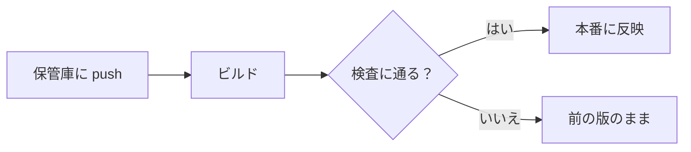

kinari-md が扱う Markdown の書き方を、ひととおり並べた見本です。見え方は md-leaf の本文と同じにします。
1つの改行は、そのまま改行になります。
**「強調」**のあとに日本語の句読点が続いても、**太字（かっこ付き）**になります。*斜体*、~~取り消し線~~、`インラインのコード`、[外へのリンク](https://example.com) も使えます。

## 見出し2

本文の段落です。長い文章は、紙の本のように落ち着いて読めることを大事にします。スマホの狭い幅でも、行の長さと行間がちょうどよくなるようにしています。

### 見出し3

- 箇条書きの1つ目
- 2つ目
  - 入れ子の項目
  - もう1つ
- 3つ目

1. 番号付きの1つ目
2. 2つ目
3. 3つ目

- [x] 終わったタスク
- [ ] まだのタスク

> ふつうの引用です。誰かの言葉や、ほかの資料から引いた文を置きます。

## コード

```typescript
// 問題を解いた日を数える
export function countDays(answers: Answer[]): number {
  const days = new Set(answers.map((a) => a.date));
  return days.size;
}
```

```python
def greet(name: str) -> str:
    """あいさつを返す"""
    return f"こんにちは、{name}さん"
```

```sql
SELECT subject, COUNT(*) AS total
FROM questions
WHERE flagged = false
GROUP BY subject;
```

```
言語を書かないコードブロックは、色を付けずにそのまま出します。
```

## 表

| 用語 | 意味 | 例 |
| --- | --- | --- |
| ノート | md ファイル1つ | `index.md` |
| コールアウト | 囲みの強調表示 | `> [!note]` |
| フロントマター | 先頭の `---` で囲んだ YAML。`title` だけを使い、ほかの項目は本文に出さない | `title: 見本` |

## 数式

文の中の数式 $E = mc^2$ と、ブロックの数式です。

$$
\sum_{k=1}^{n} k = \frac{n(n+1)}{2}
$$

## コールアウト

> [!note]
> note：補足の情報です。

> [!tip] 覚え方のコツ
> tip：題を付けることもできます。

> [!warning]
> warning：気をつけることです。

> [!danger]
> danger：やってはいけないことです。

> [!abstract]
> abstract：まとめです。

> [!important]
> important：大事なことです。

> [!caution]
> caution：注意することです。

> [!question]- 折りたたみ（押すと開く）
> 閉じた状態で始まるコールアウトです。中にも **Markdown** を書けます。
>
> ```bash
> npm run build
> ```

## 図（Mermaid）


