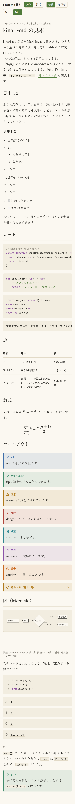
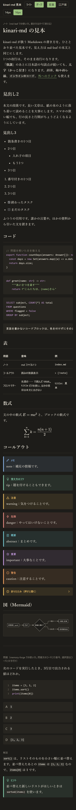
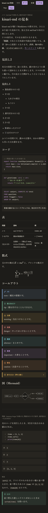
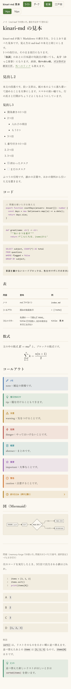
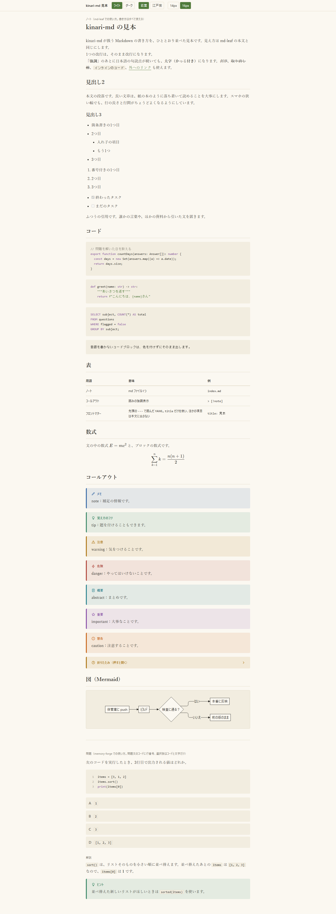
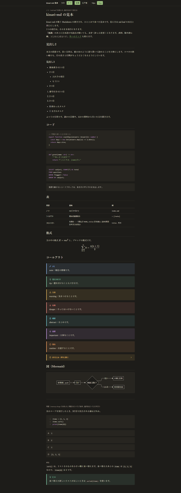

<!--
変更の仕様のひな形。コピーして docs/changes/<年-月-日>-<何をするか>.md を作る（例：2026-09-17-add-due-date.md）。
「なぜ」〜「調べたこと」は、AIが下書きし、人間がプロトタイプを触って直し、合意して決める（/dev-proto）。「画面」のスクリーンショットは、合意したときに足す。
「設計」以降はAIが書いて実装まで進め、人間は機能の PR でレビューする（/dev-build）。
スクリーンショットは、このファイルと同じ名前のフォルダに置く（例：2026-09-17-add-due-date/list-empty.png）。
-->

# 使う書き方を絞り、安全な HTML にできる（#4）

## なぜ

memory-forge は、問題文・選択肢・解説を自前の小さな変換（文の中のコードとコードブロックだけ）と Prism で出している。kinari-md に替えて Prism を外すには（`docs/overview.md` の「アプリが移る順番」の4）、次の3つが要る。

- 場所ごとに使う書き方を絞る。選択肢でまで見出しやコールアウトが効くと、問題の画面が崩れる
- データベースから来る文字でも、安全な HTML にする
- 問題文のコードブロックに行番号を付ける（「3行目で出力される値は」のような問題があるため）

あわせて、文の中のコード（`` ` `` で囲んだもの）を今より目立たせる。今は地の色だけで、選択肢の箱のように地の近い場所では見分けにくい（プロトタイプで決めた）。

v0.2.0 として出す。

## 影響する今の仕様

- `docs/specs/markdown.md`：「変換（`renderMarkdown`）」に、選べるもの（書き方を絞る・行番号）と安全にする決まりを足す。「本文の見た目」に行番号と文の中のコードの見た目を足す
- `docs/ui.md`：「部品の使い分け」の「文の中のコード」の地と余白を直す（機能の仕上げで）
- `docs/specs/screens/`：文の中のコードの見た目が変わるので、見本のページの画像はすべて撮り直す
- `docs/specs/sample-page.md`：「ページの中身」と「画面」に、問題の部分を足す

## 使う場面

1. memory-forge が、問題文「次のコードを実行したとき、3行目で出力される値はどれか。」と Python の3行のコードを、コードだけ・行番号ありで変換する。コードは色分けされ、左に 1・2・3 の番号が付く。答える人がコードを選んで写すと、番号は入らない
2. 選択肢を作った人が、うっかり `# 1` や `**1**` と書いた。選択肢はコードだけで変換するので、見出しや太字にならず、`# 1`・`**1**` と書いたままの文字で出る。`` `[1, 2, 3]` `` は文の中のコードとして出る
3. データベースの解説に `[ここを押す](javascript:alert(1))` と `<script>alert(1)</script>` が入っていた。すべての書き方で変換しても、「ここを押す」はリンクにならず文字で出て、`<script>…</script>` も文字のまま出る。押しても何も動かない

## 受け入れ条件

### 書き方を絞る

- 呼ぶ側が、書き方を「すべて」か「コードだけ」から選べる。選ばなければ「すべて」で、v0.1.1 と同じ HTML になる（下の「安全にする」で変わるものを除く）
- 「コードだけ」で出すのは、段落・改行（1つの改行も改行になる）・文の中のコード・コードブロック（色分けあり）だけ
- 「コードだけ」のとき、それ以外の書き方（見出し・リスト・引用・コールアウト・表・強調・取り消し線・リンク・自動リンク・画像・数式・タスク・区切り線・フロントマター）は、書いたままの文字で出す（`# 1` は「# 1」、`**1**` は「\*\*1\*\*」、`[a](b)` は「[a](b)」）
- 「コードだけ」のとき、`mermaid` のコードブロックは図にせず、色を付けないコードブロックで出す
- 「コードだけ」のとき、`title` はいつも `undefined`、`headings` はいつも空
- 書き換えの関数（`resolve`）は、「コードだけ」でも渡せる（リンクと画像がないので呼ばれない）

### 安全にする

- 書き方を選んでも選ばなくても、いつも安全にする（呼ぶ側では切れない）
- リンクの行き先が、相対・`#` で始まるもの・`/` で始まるもの・`http:`・`https:`・`mailto:` のどれでもないとき（`javascript:`・`data:`・`vbscript:` など。大文字・空白・符号化で隠したものも）、リンクにせず、リンクの文字だけを出す
- 画像の場所が、相対・`/` で始まるもの・`http:`・`https:` のどれでもないとき、画像にせず、代わりの文字（alt）だけを文字で出す。代わりの文字がなければ何も出さない
- 本文の中の HTML のタグは、今までどおり文字として出す（動かさない）
- 数式の中のリンク（`\href`・`\url`）は、リンクにならない
- 上のどれに当たっても、変換は止まらず、ほかの部分はふつうに出る

### 行番号

- 呼ぶ側が、行番号を付けるかを選べる。選ばなければ付けない
- 付けると、その変換の中のコードブロックすべてに、1から始まる行番号が付く（`mermaid` のブロックには付けない）。文の中のコードには付けない
- 行番号は、コードの行ごとに、code-line の色で右にそろえて出す。何桁になってもコードの始まりの位置はそろう
- 複数行にまたがる文字列やコメントがあっても、色分けと行番号がずれない
- コードを選んで写すとき、行番号は入らない
- 長い行は今までどおり折り返さず、行番号ごと枠の中で横にスクロールする

### 文の中のコード

- 文の中のコードは、枠を付けず、今より少し濃い地（文字の色を地に薄く混ぜた色）で出す（本文・リスト・コールアウトの中・見出しの中も）
- コールアウトの中や選択肢の箱の中のように地の色がある場所でも、ライトとダークのどちらでも、地が見分けられる
- 箱の中で、文字が上下の真ん中に見える（括弧のある `sort()`・`[1, 2, 3]` でも上と下のすき間がそろう）。箱の上下は、まわりの日本語の文字の高さにそろう
- 左右の余白は小さくする。日本語とコードのあいだの空白は、書いたまま出す（変換で消さない）
- 表の中のコードは、今までどおり等幅にするだけで、地を付けない
- コードブロックの見た目は変えない
- `kinari-md/body.css` の見た目なので、md-leaf の本文も同じように変わる

### 見本のページ

- ノートの本文のあとに、問題の部分を足す（合意した画像のとおり）
  - 小さな説明「問題（memory-forge での使い方。問題文のコードに行番号、選択肢はコードと文字だけ）」
  - 問題文：コードだけ・行番号ありで変換したもの
  - 選択肢4つ：コードだけで変換したもの。A〜D の記号を付けた地の色の箱に入れる（箱は見本のための仮の見た目）。選択肢の中のコードも、本文の文の中のコードと同じ見た目にする
  - 小さな説明「解説」と、すべての書き方で変換した解説（コールアウトを含む）
- ライト・ダーク・差し色・文字の大きさの切り替えは、問題の部分にも効く

### 版

- v0.2.0 として出し、`CHANGELOG.md` に入ったもの（壊れる変更があればそれも）と、変わった見た目（文の中のコードの地と余白）を書く

## 画面

### 見本のページ（sample）

変わるのは、ノートの本文のあとに足す問題の部分と、文の中のコードの見た目。ほかの部分は今の画面（`docs/specs/screens/`）のまま。問題の部分は立ち上げで合意した画面（`docs/agreed-screens/`）のとおりで、文の中のコードの見た目はこの機能のプロトタイプで決めた。

| 状態 | 表示 | スクリーンショット |
| --- | --- | --- |
| ライト・若葉・16px（スマホ） | ノートのあとに、問題文（行番号つきのコード）・選択肢 A〜D の箱・解説（ヒントのコールアウト）が並ぶ。文の中のコードは枠のない、少し濃い地 |  |
| ダーク・若葉・16px（スマホ） | 同じ。墨の地 |  |
| ダーク・江戸紫（スマホ） | 問題の部分も、差し色が江戸紫になる |  |
| ライト・14px（スマホ） | 問題の部分も、本文と同じく小さくなる |  |
| ライト（PC） | 問題の部分も、prose の幅で真ん中 |  |
| ダーク（PC） | 同じ。墨の地 |  |

- スクリーンショットはプロトタイプ（md-leaf の変換で作ったもの）で撮った。文字の倍率は v0.1.1 で直す前のものなので、見出しなどの大きさは今の本番（`docs/specs/screens/`）に合わせる

- 文の中のコード（`docs/ui.md` の「文の中のコード」を直す）。プロトタイプで決めた値：
  - 地：`color-mix(in srgb, var(--color-text) 9%, var(--color-bg))`。枠なし、角丸は radius-sm。トークンを増やさない（コールアウトの薄い地と同じ作り方）
  - 余白：上 0.05em・左右 0.2em・下 0.25em。等幅の書体は括弧が下に伸びるので、上を狭く下を広くして、文字を箱の上下の真ん中に見せる
  - 位置：`vertical-align: 0.12em` で少し上げ、箱を日本語の文字の高さにそろえる
  - 上の値は、プロトタイプ（Windows の等幅の書体）で測って決めた。本番の画像を撮る環境は等幅の書体が違うので、撮り直した画像で、括弧のあるコードの上下のすき間がそろっているかを確かめ、ずれていれば上下の余白だけを直す
- 行番号：code-line の色、右にそろえ、番号とコードのあいだを空ける。選んで写すときに含めない（`docs/ui.md` の「コードブロック」にすでにある）
- 選択肢の箱：code-bg の地、角丸、A〜D の記号はゴシック。箱どうしのあいだを空ける。見本だけの見た目で、kinari-md の見た目ではない（`docs/ui.md` の「見本のページ」にすでにある）
- 小さな説明（「問題…」「解説」）：ノートの説明と同じ、muted の小さなゴシック

## やらないこと

- 「すべて」と「コードだけ」のほかの組み合わせ（書き方を1つずつ選ぶなど）。使うアプリがまだないため（`docs/overview.md` の「やらないこと」）
- 行番号をブロックごとに選ぶこと（Markdown の中に印を書くなど）
- 本物の選択肢の見た目（memory-forge が持つ）
- memory-forge を kinari-md に替えること（memory-forge の /dev-proto で行う）

## 先に要る機能

- #2（Markdown を md-leaf と同じ HTML と見た目にできる）：main に入っている（v0.1.0）

## 決まっていないこと

- [x] Q1. 書き方の選び方は、「すべて」と「コードだけ」の2つでよい？（推す答え：2つ） → 2つ
  - 2つ：memory-forge の今の書き方（コードだけ）と解説（すべて）にちょうど合い、受け入れ条件とテストが少ない。ほかの組み合わせが要るアプリが出たら足す（v0.x は壊れる変更も入れてよい）
  - 書き方を1つずつ選べる一覧：どのアプリにも合わせられるが、使わない組み合わせまで確かめることになり、「使うアプリがまだない書き方を先に作らない」に触れる
- [x] Q2. 「コードだけ」のときに、絞った外の書き方（見出し・コールアウトなど）をどう出す？（推す答え：書いたままの文字） → 書いたままの文字
  - 書いたままの文字（`# 1` → 「# 1」）：memory-forge の今の出し方と同じで、問題を作った人が書き間違いに気づける
  - 印だけ外して中の文字を出す（`# 1` → 「1」）：見た目はすっきりするが、書いたものと違う文字が出て、間違いに気づきにくい
  - 絞らずにそのまま出す：問題の画面が崩れる
- [x] Q3. 安全にするやり方は？（推す答え：自前で、リンクと画像の行き先を決まったものだけ通す） → 自前
  - 自前：今の「HTML のタグは文字にし、raw を作るのは KaTeX と highlight.js だけ」を続け、そのうえで、リンクと画像の行き先を決まった形（相対・`http(s):`・`mailto:`）だけ通す。新しいライブラリが要らず、本文の HTML の形も変わらない。足りなくなるのは、新しい要素や属性を出す処理を足したときなので、そのとき見直す前提を `docs/design.md` に書く
  - rehype-sanitize（unified の公式。MIT）：出す要素と属性を一覧で絞るので、思いつかなかった穴もふさげる。ただし、最後のリリースが 2023-11 で「AIが決めてよい」の条件（1年以内）に合わない。コールアウトのアイコン（svg）・`data-*`・`details` などを一覧に足し続ける手間があり、KaTeX と highlight.js の結果（raw）は見られないので、その前に置く必要がある
- [x] Q4. 行番号は、変換ごとに選ぶ（その変換のコードブロックすべてに付く）でよい？（推す答え：変換ごと） → 変換ごと
  - 変換ごと：memory-forge の今の作り（問題文のコードすべてに付く）と同じで、呼ぶ側が決められる
  - ブロックごと（` ```python lines ` のように Markdown に印を書く）：問題を作る人が選べるが、データに印が入り、問題の作り方の決まりも変わる
- [x] Q5. 文の中のコードを目立たせる変更は、#4 に入れる？別の Issue にする？（推す答え：別の Issue。md-leaf が画面を変えずに替え終わってから入れられる） → #4 に入れる
- [x] Q6. 文の中のコードの見た目は？ → 墨を混ぜた地（枠なし）
  - 最初は A 枠（code-bg の地に border の枠）に決めたが、プロトタイプで見ると、括弧が枠に触れ、枠の色も薄く見にくかった。枠を濃くすると、明朝の本文の中で部品のように見えて安っぽいので、枠をやめた
  - 枠なしで比べた案：元の地に余白だけ（コールアウトや選択肢の中で見えない）、墨を混ぜた地（どこでも見え、本文から浮かない。これに決めた）、差し色を混ぜた地（ヒントのコールアウトの中で見分けにくい）、薄い地＋コードの色（江戸紫ではリンクの色と近い）
- [x] Q7. 文の中のコードのまわりのすき間は？（推す答え：左右の余白を小さくし、日本語との空白は書いたまま） → 推す答えのとおり。上下の余白は、文字が箱の上下の真ん中に見えるようにそろえる
  - 比べた案：変換で日本語とコードのあいだの空白を消す（詰まりすぎる）、空白を消して CSS で決まったすき間を取る（行の頭のコードまで右にずれる）。どちらも出す HTML が md-leaf と変わる

## 技術の確認表

| 項目 | 当てはまるもの | 決めた人 |
| --- | --- | --- |
| 保存するデータ | なし | AI |
| 外部サービス | なし | AI |
| 認証・権限 | なし | AI |
| 費用 | なし | AI |
| 個人情報 | なし | AI |
| デプロイの環境 | なし（見本のページのデプロイの仕方は変わらない） | AI |
| 新しいライブラリ | なし（Q3 で自前に決めた） | 人（Q3） |
| 取り消せない操作 | なし | AI |
| 共通の部品・トークン | 文の中のコードの見た目（`body.css`）を変え、md-leaf の本文にも効く。トークンは増やさない（地は `--color-text` を `--color-bg` に混ぜて作り、角丸は `--radius-sm`。行番号の色 `--color-code-line` もすでにある） | 人（Q5・Q6・Q7） |
| `docs/design.md` の決まり | 「ノートの HTML は文字にし、raw を作るのは KaTeX と highlight.js だけにする」の前提（「サニタイズ（#4）を入れたら見直す」）を、自前で安全にする形（リンクと画像の行き先を決まった形だけ通す。新しい要素や属性を出す処理を足したら見直す）に直す。「アプリから渡す関数の形」に、選べるもの（書き方・行番号）を足す | 人（Q3） |

## 調べたこと

- memory-forge の今の作り：問題文・選択肢・解説とも、文の中のコードとコードブロックだけを読む自前の変換（`src/server/questions/markup`）で、問題文だけ行番号を付けている（`RichText` の `lineNumbers`）
- KaTeX は、`trust` を付けなければ `\href`・`\url` をリンクにしない（既定は付けない）

---

## 設計

<!--
変えるファイル、データの変更、やり方を選んだ理由。
理由と前提には、仕上げたあとに残す場所も書く（そのコードだけに関わるならコメント、複数の場所に関わるなら docs/design.md）。
docs/design.md と食い違う設計になるなら、そのことも書く
-->

### 変えるファイル

| ファイル | 変えること |
| --- | --- |
| `src/markdown/render.ts` | `RenderOptions` に `syntax?: "all" \| "code"` と `lineNumbers?: boolean` を足す。unified の処理を「すべて」と「コードだけ」の2つ作り、`syntax` で選ぶ。`lineNumbers` と書き方は、`resolve` と同じく `VFile` の `data` で渡す |
| `src/markdown/safe-urls.ts`（新しく作る） | リンクと画像の行き先を決まった形だけ通す rehype の処理。通さない a は中の子に置き換え、通さない img は alt の文字（なければ何も出さない）に置き換える。両方の処理（すべて・コードだけ）で、remark-rehype のすぐ後（`rewriteLinks` より前）に置く |
| `src/markdown/highlight.ts` | 「コードだけ」では `mermaid` に `data-mermaid` の印を付けない。`lineNumbers` のとき、色分けのあと、コードを行ごとの `span.code-line` に分ける。highlight.js の結果（raw）は、行の終わりで開いている `span` を閉じ、次の行の頭で開き直す（複数行の文字列・コメントでもずれない）。色分けしないコードは、文字のノード（hast）のまま行に分ける（raw を作らない）。`pre` に `line-numbers` のクラスと、行数の桁を `style="--line-digits: N"` で付ける（mermaid のブロックには付けない） |
| `src/styles/body.css` | 行番号：`pre.line-numbers` で CSS のカウンターを `.code-line::before` に出す（code-line の色、`min-width: calc(var(--line-digits) * 1ch)` で右にそろえ、右に余白）。文の中のコード：地を `color-mix(in srgb, var(--color-text) 9%, var(--color-bg))`、余白を上 0.05em・左右 0.2em・下 0.25em、`vertical-align: 0.12em`。表の中のコードは今までどおり（余白・地・位置を戻す） |
| `sample/app/page.tsx`、`sample/app/question.ts`（新しく作る）、`sample/app/tokens.css` | ノートのあとに問題の部分を足す。問題文・選択肢・解説の Markdown は `question.ts` に置く。選択肢の箱の地は、見本の `@theme` に `--color-choice: var(--color-code-bg)` を足して `bg-choice` で塗る（Tailwind の任意の値を使わないため。`--color-code-bg` と同じ名前にすると kinari-md の値を上書きするので別の名前） |
| `e2e/sample.spec.ts` | 問題の部分のテスト（行番号が出る・写すときに入らない） |
| `package.json`・`CHANGELOG.md` | v0.2.0 |
| `docs/specs/markdown.md`・`docs/specs/sample-page.md`・`docs/ui.md`・`docs/design.md` | 仕上げで反映する |

### データの変更

保存するデータはない。受け渡しの形だけが変わる。返すもの（`RenderedMarkdown`）の形は変わらない。

```ts
type RenderOptions = {
  resolve?: Resolve;
  syntax?: "all" | "code"; // 既定 "all"
  lineNumbers?: boolean; // 既定 false
};
```

### やり方を選んだ理由

- **「コードだけ」は、読み込み（micromark）の書き方を止めて作る**：remark-parse に `micromarkExtensions` の `disable.null` で、見出し（`headingAtx`・`setextUnderline`）・リスト・引用・区切り線・強調（`attention`）・リンクと画像（`labelStartLink`・`labelStartImage`・`labelEnd`・`definition`）・自動リンク・HTML（`htmlFlow`・`htmlText`）・字下げのコード（`codeIndented`）・文字の参照と `\` の逃がし（`characterReference`・`characterEscape`）を止め、GFM・数式・フロントマター・コールアウトのプラグインは入れない。止めた書き方は読まれないので、書いたままの文字になる。比べた案：すべての書き方で読んでから、絞った外のノードを元の文字に戻す（元の文字の位置を拾い直す処理が要り、入れ子で崩れやすい）。残す場所：`render.ts` のコメント
- **行の頭の行番号は CSS のカウンター（`::before`）で出す**：生成した文字は選んで写すときに入らない。番号を要素で出して `user-select: none` にする案は、ブラウザによって写すときに入る。残す場所：`body.css` のコメント
- **桁は `--line-digits` を `pre` に付けて決める**：何桁でもコードの始まりをそろえるのに、ブロックの行数の桁が要る。CSS の `attr()` は幅に使えないため。値は行数でトークンではないので、トークンの決まりに当たらない。残す場所：`highlight.ts` のコメント
- **安全にする処理は rehype で、`rewriteLinks` より前に置く**：書き換えの関数に危ない行き先が渡らないようにする。行き先を見るときは、ブラウザと同じく先頭の制御文字・空白を除き、タブ・改行を消してからスキームを読む（`java\tscript:`・` javascript:` を見逃さない）。文字の参照（`&#106;avascript:`）は読み込みで戻ってから見るので、同じ決まりで止まる。残す場所：`docs/design.md` の「ノートの HTML は文字にし、raw を作るのは KaTeX と highlight.js だけにする」を直す（前提：新しい要素や属性を出す処理を足したら見直す）
- **数式のリンク**：KaTeX は `trust` を付けなければ `\href`・`\url` をリンクにしない。今のまま（`math.ts` に `trust` を付けない）で、テストで確かめる

## AIが決めたこと

- 選ぶものの名前：`renderMarkdown(source, { syntax?: "all" | "code", lineNumbers?: boolean })`。理由：今の `options` に足すだけで、v0.1.x の呼び方がそのまま動く
- 安全にするのは、いつも行う（呼ぶ側では切れない）。理由：md-leaf のノートでも `javascript:` のリンクが動く必要はなく、切れると付け忘れが穴になる
- 通さないリンクは文字だけ、通さない画像は代わりの文字だけを出す。理由：消すと文が欠け、書いた人が気づけない
- 「コードだけ」のとき、フロントマターは読まず書いたままの文字にし、`mermaid` は図にしない。理由：問題のデータに題や図はなく、絞った外の書き方と同じ扱いにそろえる
- 見本の選択肢の箱の見た目は、見本のページの CSS に置く（kinari-md の `body.css` には入れない）。理由：本物の選択肢は memory-forge が持つ（`docs/ui.md` の「見本のページ」）
- 通す行き先：リンクは相対・`#`・`/`・`http:`・`https:`・`mailto:`、画像は相対・`/`・`http:`・`https:`（受け入れ条件のとおり）。比べた案：通さないものの一覧（`javascript:` など）を持つ（知らないスキームを通してしまう）
- 「コードだけ」では字下げのコード・文字の参照・`\` の逃がしも止める。理由：「書いたままの文字」にそろえ、memory-forge の今の変換（フェンスのコードしか読まない）と同じにする。比べた案：CommonMark のまま残す（`\*` が `*` になり、書いたものと違う文字が出る。4つの空白で字下げした文がコードになる）
- 「コードだけ」では、行の終わりの `\` で改行にする書き方（`hardBreakEscape`）も止める。理由：1つの改行はもともと改行になり、止めないと `\` が消えて書いたものと違う文字が出る
- 行番号の要素は行ごとの `span.code-line`、`pre` に `line-numbers` のクラス。比べた案：表（`table`）で番号の列を作る（写すときに番号が入り、横のスクロールが番号ごとにならない）

## 確かめ方

| 受け入れ条件 | 確かめ方 |
| --- | --- |
| 書き方を絞る（選ばなければ「すべて」で同じ HTML、「コードだけ」で出すもの・文字で出すもの、mermaid、title・headings、resolve を渡せる） | テスト（`src/markdown/render.test.ts`） |
| 安全にする（危ないリンク・画像、隠したもの、HTML のタグ、数式のリンク、変換が止まらない、どの書き方でも） | テスト（`src/markdown/safe-urls.test.ts`） |
| 行番号（選べる、すべてのブロック・mermaid と文の中には付けない、複数行の文字列・コメント） | テスト（`src/markdown/highlight.test.ts`） |
| 行番号を写すときに入らない | テスト（`e2e/sample.spec.ts`。問題文のコードを選んで写した文字に番号がない） |
| 行番号の見た目（code-line の色、右にそろう、桁がそろう、長い行は横にスクロール） | テスト（画像を比べる）と、コードを見て確かめる（`src/styles/body.css` の行番号） |
| 文の中のコードの見た目（地・余白・位置、表の中は地なし、コードブロックは変えない、md-leaf にも効く） | テスト（画像を比べる）と、コードを見て確かめる（`src/styles/body.css` の文の中のコード） |
| 文の中のコードがライトとダークで見分けられる・文字が上下の真ん中に見える | 触って確かめる（見本のページをライトとダークで開き、選択肢の箱とコールアウトの中の `sort()`・`[1, 2, 3]` を見る） |
| 見本のページの問題の部分・切り替えが効く | テスト（画像を比べる。6つの状態） |
| v0.2.0 と CHANGELOG | コードを見て確かめる（`package.json`・`CHANGELOG.md`） |

## タスク

- [x] 1. どの書き方でも、危ないリンクと画像を通さず文字で出せる（`safe-urls.ts`・`render.ts`。画面は変わらない）
- [x] 2. 「コードだけ」を選ぶと、段落・改行・文の中のコード・コードブロックだけを出せる（`render.ts`・`highlight.ts`）
- [x] 3. 行番号を選ぶと、コードブロックに行番号が付き、写すときに入らない見た目で出せる（`highlight.ts`・`body.css` の行番号。見本はまだ使わないので画像は変わらない）
- [x] 4. 文の中のコードが、墨を混ぜた地と決めた余白で出る（`body.css`。見本のページの画像6つを撮り直す。合わせるもの：`sample-light.png`・`sample-dark.png` の本文の文の中のコード）
- [x] 5. 見本のページに問題の部分（問題文・選択肢 A〜D・解説）が出る（`sample/`・`e2e/`。画像6つを撮り直す。合わせるもの：`sample-light.png`・`sample-dark.png`・`sample-dark-forge.png`・`sample-light-14.png`・`sample-light-pc.png`・`sample-dark-pc.png`）
- [ ] 6. 版を v0.2.0 にし、`CHANGELOG.md` に入ったものと変わった見た目を書く
