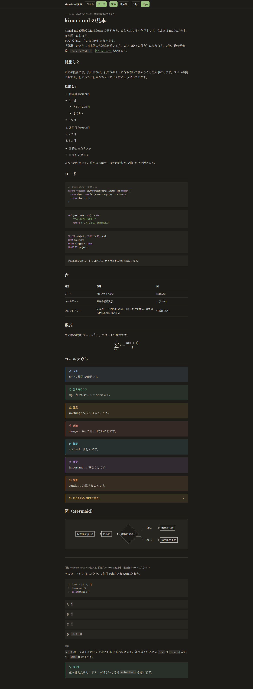

# 見本のページ

`sample/` の Next.js のページ（`npm run dev` で http://localhost:3000）。パッケージには入らない。

## ページの中身

- 上の帯：題「kinari-md 見本」と、ボタンの3つの組（ライト/ダーク・若葉/江戸紫・14px/16px）
- 「ノート（md-leaf での使い方。書き方はすべて使える）」の小さな説明、題（見本の本文のフロントマターの `title`「kinari-md の見本」）、見本の本文
- 見本の本文は `sample/app/note.md`。`renderMarkdown` で変換し、`.kinari-body` に入れ、`drawMermaid` で図を描く（段落と強調・見出し・リスト・タスク・引用・コード・表・数式・コールアウト（7色と折りたたみ）・図）
- 帯の中身と本文は、PC の幅では本文の幅（prose）で真ん中にそろう

## 帯

- ボタンを押すと、すぐにその見た目になる。選んでいるボタンは差し色の地になる（`aria-pressed="true"`）
- 選んだものは URL に `?theme=…&accent=…&size=…` の3つとも書かれる（履歴は増えない）。保存はしない
- その URL で開くと、最初から同じ見た目で開く。URL に何もないとき・知らない値のときは、ライト・若葉・16px
- 選んだものは `<html>` の `data-theme`（`light`・`dark`）・`data-accent`（`leaf`・`forge`）・`data-size`（`14`・`16`）に映る。14px/16px は本文の文字の大きさ（`--reading-size`）だけを変え、帯は変わらない
- ダークにすると、図はダークの色で描き直される
- 帯はスクロールしても画面の上に残る。幅が足りないときは、ボタンの組ごとに折り返す

## 画面

| 状態 | URL | 表示 | スクリーンショット |
| --- | --- | --- | --- |
| ライト・若葉・16px（スマホ） | `/` | 生成りの地。リンクと選んだボタンが若葉 |  |
| ダーク・若葉・16px（スマホ） | `/?theme=dark` | 同じ。墨の地 |  |
| ダーク・江戸紫（スマホ） | `/?theme=dark&accent=forge` | リンク・選んだボタンが江戸紫 |  |
| ライト・14px（スマホ） | `/?size=14` | 本文と見出しが小さくなる。帯と図の字は変わらない |  |
| ライト（PC） | `/` | 帯の中身と本文が prose の幅で真ん中 |  |
| ダーク（PC） | `/?theme=dark` | 同じ。墨の地 |  |

- スマホは幅 390、PC は幅 1440 で撮る
- 画像に写らない状態：折りたたみのコールアウトを開いた状態（見出しを押すと開き、もう一度押すと閉じる）、描けない Mermaid の図（元のコードのまま残る。見本の本文には入っていない）
